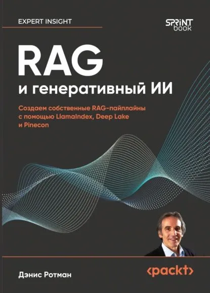

# [Книга][Дэнис Ротман] RAG и генеративный ИИ. Создаем собственные RAG-пайплайны с помощью LlamaIndex, Deep Lake и Pinecon [RUS, 2025]

**Оригинальные исходники:**  
https://github.com/Denis2054/RAG-Driven-Generative-AI



<br/>

### Описание

В книге описываются приемы создания эффективных больших языковых моделей, систем компьютерного зрения и генеративного ИИ, показывающих высокую производительность при относительно невысоких затратах. В ней приводится подробное исследование технологии RAG, а также подходов к проектированию мультимодальных пайплайнов ИИ и управлению ими. Связывая вывод с исходными документами, RAG повышает точность и контекстную релевантность результатов, предлагая динамический подход к управлению большими объемами информации.

Узнайте, как построить инфраструктуру RAG, попутно разобравшись с векторными хранилищами, фрагментацией, индексацией и ранжированием. Познакомьтесь с методами оптимизации производительности и приемами более глубокого изучения данных, включая использование адаптивного RAG и обратной связи от человека для уточнения поиска, тонкую настройку RAG, реализацию динамических RAG для поддержки принятия решений в реальном времени и визуализацию сложных данных с помощью графов знаний. Вы также увидите, как на практике объединить такие фреймворки, как LlamaIndex и Deep Lake, векторные базы данных наподобие Pinecone и Chroma и модели, предлагаемые компаниями Hugging Face и OpenAI. Приобретите навыки внедрения интеллектуальных решений, что повысит вашу конкурентоспособность в различных областях: от продакшна до обслуживания клиентов в любом проекте.

<br/>

### Чему можно научиться:

<ul>
  <li>Масштабирование конвейеров RAG для эффективной обработки больших наборов данных</li>
  <li>Применение методов для минимизации галлюцинаций и обеспечения точных ответов</li>
  <li>Внедрение методов индексации для повышения точности ИИ с отслеживаемыми и прозрачными результатами</li>
  <li>Адаптация и масштабирование систем генеративного ИИ на базе RAG в различных предметных областях</li>
  <li>Использование Deep Lake и Pinecone для эффективного и быстрого извлечения данных</li>
  <li>Управление и создание надежных систем генеративного ИИ, основанных на реальных данных</li>
  <li>Объединение текстовых и графических данных для получения более содержательных и информативных ответов ИИ</li>
</ul>

<br/>

### Краткое содержание

- :white_check_mark: :book: :hammer_and_wrench: **01.** Почему именно генерация с дополненной выборкой (RAG)
- **02.** Хранение эмбеддингов RAG с помощью Deep Lake и OpenAI
- **03.** Реализация индексированной RAG с помощью LlamaIndex, Deep Lake и OpenAI
- **04.** Мультимодальная RAG
- **05.** Повышение эффективности RAG за счет обратной связи от эксперта
- **06.** Масштабирование банковских данных клиентов в системе RAG с помощью Pinecone
- **07.** Создание масштабируемой RAG на основе графа знаний с помощью API Википедии и LlamaIndex
- **08.** Создание динамических RAG с помощью Chroma и Hugging Face Llama
- **09.** Улучшение моделей ИИ: тонкая настройка данных RAG и обратная связь
- **10.** RAG для создания стоковых видео с помощью Pinecone и OpenAI

<br/>

### Требования для работы с книгой

Необходимы базовые знания в области **обработки естественного языка** (**NLP**) и некоторый опыт работы с Python. Большинство программ в этой книге представлены в виде блокнотов Jupyter. Для их запуска требуется только бесплатный аккаунт Google Gmail, позволяющий выполнять блокноты на бесплатной **виртуальной машине** (**VM**) Google Colaboratory.

Также потребуется сгенерировать API-токены для OpenAI, Activeloop и Pinecone.

<br/>

### Подготовка окружения для запуска примеров

```shell
$ git clone git@github.com:webmakaka/RAG-Driven-Generative-AI.git
$ cd RAG-Driven-Generative-AI/
```

<br/>

```shell
$ pip install uv --break-system-packages
$ uv venv --python=python3.12
$ source .venv/bin/activate
$ uv pip install -r requirements.txt
```

<br/>

```shell
$ python -m spacy download en_core_web_sm
```

<br/>

### Модель - Бесплатная LLM Groq. Требуется регистрация + токен + ограничения + VPN

<br/>

### Запуск примеров в облаках

| Глава | Colab | Kaggle |
| :---- | :---- | :----- |
**01. Почему именно генерация с дополненной выборкой (RAG)**
| <ul><li>RAG_Overview.ipynb</a></li> |[](https://colab.research.google.com/github/Denis2054/RAG-Driven-Generative-AI/blob/main/Chapter01/RAG_Overview.ipynb) | <a href="https://www.kaggle.com/kernels/welcome?src=https://github.com/Denis2054/RAG-Driven-Generative-AI/blob/main/Chapter01/RAG_Overview.ipynb"></a><br> |
**Обзор RAG на примере LLM модели grok-beta от компании Илона Маска xAI**
| <ul><li>🐬RAG_Overview_Grok.ipynb with Elon Musk's xAI grok-beta</li> |[](https://colab.research.google.com/github/Denis2054/RAG-Driven-Generative-AI/blob/main/Chapter01/RAG_Overview_Grok.ipynb) | <a href="https://www.kaggle.com/kernels/welcome?src=https://github.com/Denis2054/RAG-Driven-Generative-AI/blob/main/Chapter01/RAG_Overview_Grok.ipynb"></a><br> |
**02. Хранение эмбеддингов RAG с помощью Deep Lake и OpenAI**
| <ul><li>1_Data_collection_preparation.ipynb</li> |[](https://colab.research.google.com/github/Denis2054/RAG-Driven-Generative-AI/blob/main/Chapter02/1_Data_collection_preparation.ipynb) | <a href="https://www.kaggle.com/kernels/welcome?src=https://github.com/Denis2054/RAG-Driven-Generative-AI/blob/main/Chapter02/1_Data_collection_preparation.ipynb"></a><br> |
| <ul><li>2_Embeddings_vector_store.ipynb</li> |[](https://colab.research.google.com/github/Denis2054/RAG-Driven-Generative-AI/blob/main/Chapter02/2_Embeddings_vector_store.ipynb) | <a href="https://www.kaggle.com/kernels/welcome?src=https://github.com/Denis2054/RAG-Driven-Generative-AI/blob/main/Chapter02/2_Embeddings_vector_store.ipynb"></a><br> |
| <ul><li>3_Augmented_Generation.ipynb</li> |[](https://colab.research.google.com/github/Denis2054/RAG-Driven-Generative-AI/blob/main/Chapter02/3_Augmented_Generation.ipynb) | <a href="https://www.kaggle.com/kernels/welcome?src=https://github.com/Denis2054/RAG-Driven-Generative-AI/blob/main/Chapter02/3_Augmented_Generation.ipynb"></a><br> |
**RAG with OpenAI Reasoning models: the o1-preview API**
| <ul><li>🐬3_Augmented_Generation_o1_preview.ipynb</a></li> |[](https://colab.research.google.com/github/Denis2054/RAG-Driven-Generative-AI/blob/main/Chapter02/3_Augmented_Generation_o1_preview.ipynb) | <a href="https://www.kaggle.com/kernels/welcome?src=https://github.com/Denis2054/RAG-Driven-Generative-AI/blob/main/Chapter02/3_Augmented_Generation_o1_preview.ipynb"></a><br> |
**RAG with OpenAI Reasoning models: the o3 API**
| <ul><li>🐬3_Augmented_Generation_o3.ipynb</a></li> |[](https://colab.research.google.com/github/Denis2054/RAG-Driven-Generative-AI/blob/main/Chapter02/3_Augmented_Generation_o3.ipynb) | <a href="https://www.kaggle.com/kernels/welcome?src=https://github.com/Denis2054/RAG-Driven-Generative-AI/blob/main/Chapter02/3_Augmented_Generation_o3.ipynb"></a><br> |
**RAG with OpenAI Agentic GPT-4.5-preview model: API**
| <ul><li>🐬3_Augmented_Generation_GPT_4-5.ipynb</a></li> |[](https://colab.research.google.com/github/Denis2054/RAG-Driven-Generative-AI/blob/main/Chapter02/3_Augmented_Generation_GPT_4-5.ipynb) | <a href="https://www.kaggle.com/kernels/welcome?src=https://github.com/Denis2054/RAG-Driven-Generative-AI/blob/main/Chapter02/3_Augmented_Generation_GPT_4-5.ipynb"></a><br> |
**Chapter 3, Building Index-based RAG with LlamaIndex, Deep Lake, and OpenAI**
| <ul><li>Deep_Lake_LlamaIndex_OpenAI_RAG.ipynb</li></ul> | [](https://colab.research.google.com/github/Denis2054/RAG-Driven-Generative-AI/blob/main/Chapter03/Deep_Lake_LlamaIndex_OpenAI_RAG.ipynb) | <a href="https://www.kaggle.com/kernels/welcome?src=https://github.com/Denis2054/RAG-Driven-Generative-AI/blob/main/Chapter03/Deep_Lake_LlamaIndex_OpenAI_RAG.ipynb"></a><br> |
**Chapter 4, Multimodal Modular RAG for Drone Technology**
| <ul><li>Multimodal_Modular_RAG_Drones.ipynb</li> |[](https://colab.research.google.com/github/Denis2054/RAG-Driven-Generative-AI/blob/main/Chapter04/Multimodal_Modular_RAG_Drones.ipynb) | <a href="https://www.kaggle.com/kernels/welcome?src=https://github.com/Denis2054/RAG-Driven-Generative-AI/blob/main/Chapter04/Multimodal_Modular_RAG_Drones.ipynb"></a><br> |
**Chapter 5: Boosting RAG Performance with Expert Human Feedback**
| <ul><li>Adaptive_RAG.ipynb</li></ul> | [](https://colab.research.google.com/github/Denis2054/RAG-Driven-Generative-AI/blob/main/Chapter05/Adaptive_RAG.ipynb) | <a href="https://www.kaggle.com/kernels/welcome?src=https://github.com/Denis2054/RAG-Driven-Generative-AI/blob/main/Chapter05/Adaptive_RAG.ipynb"></a><br> |
**Chapter 6, Scaling RAG Bank Customer Data with Pinecone**
| <ul><li>Pipeline_1_Collecting_and_preparing_the_dataset.ipynb</li> |[](https://colab.research.google.com/github/Denis2054/RAG-Driven-Generative-AI/blob/main/Chapter06/Pipeline_1_Collecting_and_preparing_the_dataset.ipynb) | <a href="https://www.kaggle.com/kernels/welcome?src=https://github.com/Denis2054/RAG-Driven-Generative-AI/blob/main/Chapter06/Pipeline_1_Collecting_and_preparing_the_dataset.ipynb"></a><br> |
| <ul><li>Pipeline_2_Scaling_a_Pinecone_Index.ipynb</li> |[](https://colab.research.google.com/github/Denis2054/RAG-Driven-Generative-AI/blob/main/Chapter06/Pipeline_2_Scaling_a_Pinecone_Index.ipynb) | <a href="https://www.kaggle.com/kernels/welcome?src=https://github.com/Denis2054/RAG-Driven-Generative-AI/blob/main/Chapter06/Pipeline_2_Scaling_a_Pinecone_Index.ipynb"></a><br> |
| <ul><li>Pipeline_3_RAG_Generative_AI.ipynb</li> |[](https://colab.research.google.com/github/Denis2054/RAG-Driven-Generative-AI/blob/main/Chapter06/Pipeline_3_RAG_Generative_AI.ipynb) | <a href="https://www.kaggle.com/kernels/welcome?src=https://github.com/Denis2054/RAG-Driven-Generative-AI/blob/main/Chapter06/Pipeline_3_RAG_Generative_AI.ipynb"></a><br> |
**Chapter 7, Building Scalable Knowledge Graph-based RAG with Wikipedia and LlamaIndex**
| <ul><li>Tree_2_Graph.ipynb</li> |[](https://colab.research.google.com/github/Denis2054/RAG-Driven-Generative-AI/blob/main/Chapter07/Tree_2_Graph.ipynb)| <a href="https://www.kaggle.com/kernels/welcome?src=https://github.com/Denis2054/RAG-Driven-Generative-AI/blob/main/Chapter07/Tree_2_Graph.ipynb"></a><br> |
| <ul><li>Wikipedia_API.ipynb</li> |[](https://colab.research.google.com/github/Denis2054/RAG-Driven-Generative-AI/blob/main/Chapter07/Wikipedia_API.ipynb)| <a href="https://www.kaggle.com/kernels/welcome?src=https://github.com/Denis2054/RAG-Driven-Generative-AI/blob/main/Chapter07/Wikipedia_API.ipynb"></a><br> |
| <ul><li>Knowledge_Graph**Deep_Lake_LlamaIndex_OpenAI_RAG.ipynb</li> |[](https://colab.research.google.com/github/Denis2054/RAG-Driven-Generative-AI/blob/main/Chapter07/Knowledge_Graph**Deep_Lake_LlamaIndex_OpenAI_RAG.ipynb)| <a href="https://www.kaggle.com/kernels/welcome?src=https://github.com/Denis2054/RAG-Driven-Generative-AI/blob/main/Chapter07/Knowledge_Graph__Deep_Lake_LlamaIndex_OpenAI_RAG.ipynb"></a><br> |
**Chapter 8, Dynamic RAG with Chroma and Hugging Face Llama**
| <ul><li>Dynamic_RAG_with_Chroma_and_Hugging_Face.ipynb</li> |[](https://colab.research.google.com/github/Denis2054/RAG-Driven-Generative-AI/blob/main/Chapter08/Dynamic_RAG_with_Chroma_and_Hugging_Face.ipynb)| <a href="https://www.kaggle.com/kernels/welcome?src=https://github.com/Denis2054/RAG-Driven-Generative-AI/blob/main/Chapter08/Dynamic_RAG_with_Chroma_and_Hugging_Face.ipynb"></a><br> |
**Chapter 9, Empowering AI Models: Fine-Tuning RAG Data and Human Feedback**
| <ul><li>Fine_tuning_OpenAI_GPT-4o-mini.ipynb</li> |[](https://colab.research.google.com/github/Denis2054/RAG-Driven-Generative-AI/blob/main/Chapter09/Fine_tuning_OpenAI_GPT-4o-mini.ipynb)| <a href="https://www.kaggle.com/kernels/welcome?src=https://github.com/Denis2054/RAG-Driven-Generative-AI/blob/main/Chapter09/Fine_tuning_OpenAI_GPT-4o-mini.ipynb"></a><br> |
**Chapter 10, RAG for Video Stock Production with Pinecone and OpenAI**
| <ul><li>Video_dataset_visualization.ipynb</li> |[](https://colab.research.google.com/github/Denis2054/RAG-Driven-Generative-AI/blob/main/Chapter10/Video_dataset_visualization.ipynb) | <a href="https://www.kaggle.com/kernels/welcome?src=https://github.com/Denis2054/RAG-Driven-Generative-AI/blob/main/Chapter10/Video_dataset_visualization.ipynb"></a><br> |
| <ul><li>Pipeline_1_Generator_and_Commentator.ipynb</li> |[](https://colab.research.google.com/github/Denis2054/RAG-Driven-Generative-AI/blob/main/Chapter10/Pipeline_1_Generator_and_Commentator.ipynb) | <a href="https://www.kaggle.com/kernels/welcome?src=https://github.com/Denis2054/RAG-Driven-Generative-AI/blob/main/Chapter10/Pipeline_1_Generator_and_Commentator.ipynb"></a><br> |
| <ul><li>Pipeline_2_The_Vector_Store_Administrator.ipynb</li> |[](https://colab.research.google.com/github/Denis2054/RAG-Driven-Generative-AI/blob/main/Chapter10/Pipeline_2_The_Vector_Store_Administrator.ipynb) | <a href="https://www.kaggle.com/kernels/welcome?src=https://github.com/Denis2054/RAG-Driven-Generative-AI/blob/main/Chapter10/Pipeline_2_The_Vector_Store_Administrator.ipynb"></a><br> |
| <ul><li>Pipeline_3_The_Video_Expert.ipynb</li> |[](https://colab.research.google.com/github/Denis2054/RAG-Driven-Generative-AI/blob/main/Chapter10/Pipeline_3_The_Video_Expert.ipynb) | <a href="https://www.kaggle.com/kernels/welcome?src=https://github.com/Denis2054/RAG-Driven-Generative-AI/blob/main/Chapter10/Pipeline_3_The_Video_Expert.ipynb"></a><br> |

</details>
